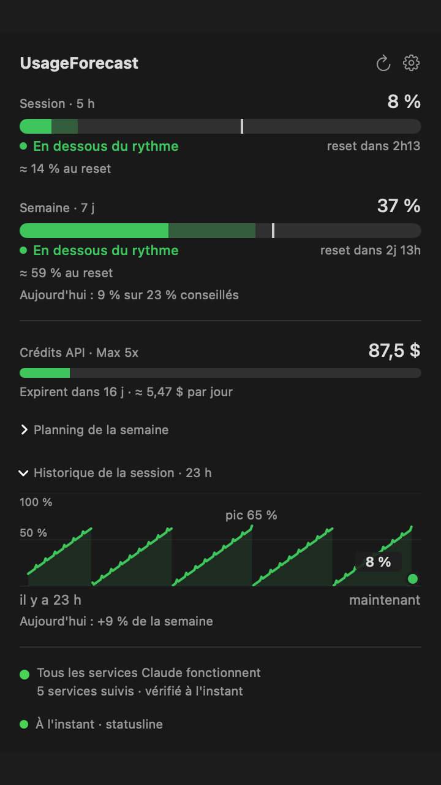
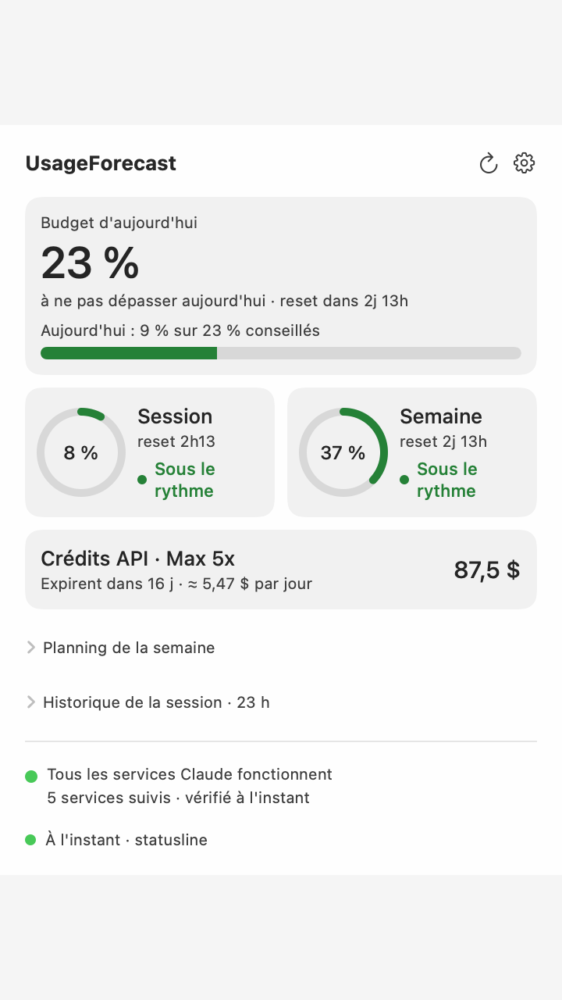
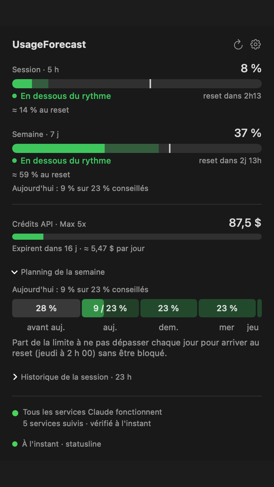
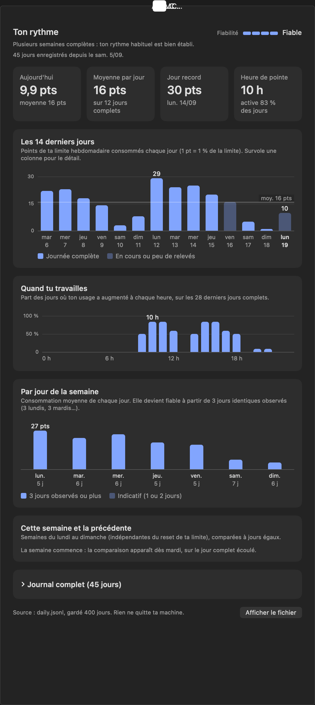

# UsageForecast

**Ton usage de Claude, ses prévisions et ses alertes, dans la barre de menu de ton Mac et sur ton téléphone.**

UsageForecast lit les limites de ton abonnement Claude (session de 5 h, semaine de 7 jours, crédits API) et te dit où tu en es **et où tu vas** : fin de semaine estimée, budget conseillé pour aujourd'hui, heure à laquelle tu atteindrais 100 %.

<p align="center">
  
  
</p>

## Installer

Mac Apple Silicon, macOS 13 ou plus récent.

```bash
curl -fsSL https://alane38.github.io/usageforecast/install.sh | sh
```

Le script télécharge la dernière release, **vérifie son empreinte SHA-256**, puis installe l'app dans Applications. Tu peux aussi télécharger le `.zip` à la main sur la [page des releases](https://github.com/Alane38/usageforecast/releases).

Ensuite, l'app se met à jour toute seule en un clic (elle vérifie l'empreinte et garde l'ancienne version dans la Corbeille).

**Désinstaller** : `curl -fsSL https://alane38.github.io/usageforecast/install.sh | sh -s -- --uninstall` (ajoute `--purge` pour mettre aussi tes données à la Corbeille).

## Ce que ça fait

- **Prévisions** : estimation à la fin de la session et de la semaine, avec un repère de rythme sur les jauges.
- **Budget du jour** : « 9 % utilisés sur 23 % conseillés », et un planning de la semaine.
- **Alertes claires** : seuils, rythme trop rapide, limite atteinte, avec l'heure du prochain reset.
- **Historique** : courbe minute par minute sur 24 h, journal quotidien gardé 400 jours, statistiques par jour de la semaine.
- **Crédits API** : solde et dépense du mois depuis la Console Anthropic (Max et Team).
- **État des services** : incidents de Claude et de l'API.
- **Barre de menu configurable** : session, semaine ou la plus haute, avec décompte avant reset.
- **Application mobile** (Android : installable depuis le navigateur ou en APK, voir [android/README.md](android/README.md)) : les mêmes écrans sur ton téléphone, chiffrés de bout en bout.
- **Assistant de premier lancement** et **mises à jour en un clic**, thème sombre par défaut.

<p align="center">
  
  
</p>

## Comment il obtient tes chiffres

1. **Le statusline de Claude Code** (recommandé) : les limites officielles que Claude Code transmet à son statusline. Aucun cookie, aucun réseau.
2. **Ton compte claude.ai** (optionnel) : un cookie de session, si tu ne passes pas par Claude Code.
3. **La Console Anthropic** (optionnel) : un second cookie, pour les crédits API.

Les cookies restent sur ton Mac : dans le trousseau macOS pour les versions publiées, un fichier protégé en développement. Rien n'est envoyé ailleurs que vers Anthropic pour les lire.

## Application mobile

Active la synchro dans les réglages, déploie ton propre relais Cloudflare (offre gratuite suffisante : environ 300 écritures par jour pour 1 000 autorisées, `scripts/deploy-relay.mjs`), puis scanne le code d'association. Tout est chiffré (AES-256-GCM) sur ton Mac avant l'envoi : le relais ne voit que du texte chiffré, la clé ne passe que par le code d'association. Détails : [mobile/README.md](mobile/README.md) et [docs/adr/002-application-mobile.md](docs/adr/002-application-mobile.md).

## Compiler

Sans Xcode.app : les Command Line Tools suffisent.

```bash
./scripts/build.sh       # développement : secrets dans un fichier protégé, aucune fenêtre du trousseau
./scripts/release.sh     # release : secrets dans le trousseau macOS
./scripts/test.sh        # tests Swift
cd mobile && bun test    # tests de l'app mobile
```

Détails du stockage des secrets : [docs/adr/001-stockage-des-secrets.md](docs/adr/001-stockage-des-secrets.md). Contexte pour les agents de code : [AGENTS.md](AGENTS.md).

## Contribuer

Les issues et suggestions sont bienvenues. Les fichiers de code restent sous 200 lignes ; `scripts/test.sh` et `scripts/visual-check.sh` doivent passer.

## Licence et avertissement

Licence **MIT** : voir [LICENSE](LICENSE).

Ce projet n'est ni affilié à Anthropic ni approuvé par Anthropic. « Claude » est une marque d'Anthropic. L'app s'appuie sur des points d'accès internes de claude.ai et de la Console qui peuvent changer sans préavis : utilisation à tes risques.
